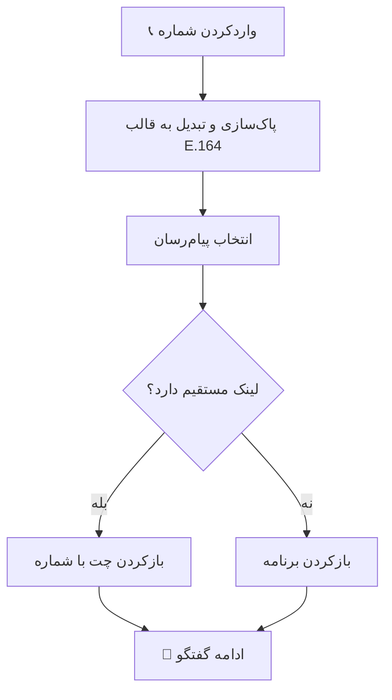

# ✨ Traceo | تریسئو

<p align="center">
  <strong>شروع گفتگو، بدون ذخیره‌کردن شماره</strong>
  <br />
  شماره را وارد کن، پیام‌رسان را انتخاب کن و مستقیم به گفتگو برو
</p>

<p align="center">
  
  
  
  
</p>

---

## 📱 Traceo چه کاری انجام می‌دهد؟

گاهی شماره‌ی فردی را داری و می‌خواهی در واتساپ، تلگرام یا پیام‌رسان دیگری به او پیام بدهی؛ اما نمی‌خواهی شماره را در مخاطبین ذخیره کنی.

Traceo برای همین موقعیت ساخته شده است: شماره را وارد می‌کنی، سرویس را انتخاب می‌کنی و برنامه تلاش می‌کند گفتگو را مستقیم در همان پیام‌رسان باز کند.

## 🧭 مسیر استفاده



## ✨ امکانات نسخه 1.1.0

- **پشتیبانی از شماره‌های ایران و خارجی:** شماره‌های ایرانی به `+98` و شماره‌های خارجی با پیش‌شماره `+` یا `00` پاک‌سازی می‌شوند.
- **پشتیبانی از اعداد فارسی و عربی:** ورودی‌هایی مثل `۰۹۱۲۳۴۵۶۷۸۹` هم پذیرفته می‌شوند.
- **لینک مستقیم چت:** واتساپ، تلگرام، سیگنال و وایبر با شماره به چت می‌روند.
- **تشخیص نصب بودن برنامه‌ها:** سرویس‌های نصب‌شده با نشان سبز مشخص می‌شوند.
- **فروشگاه و نسخه وب:** اگر برنامه نصب نباشد، Traceo فروشگاه یا نسخه وب سرویس را پیشنهاد می‌دهد.
- **کپی و اشتراک شماره:** بدون ذخیره در مخاطبین.
- **رابط کاربری کامل Jetpack Compose:** تم تاریک، Material 3، پشتیبانی RTL و صفحه‌های خانه، سرویس‌ها، جزئیات و درباره.
- **حریم خصوصی:** بدون سرور، بدون ذخیره شماره و بدون کتابخانه تبلیغاتی یا ردیاب.

## 📌 وضعیت پروژه

| مورد | مقدار |
|---|---|
| نسخه سورس | `1.1.0` (versionCode `2`) |
| حداقل اندروید | 8.0 (API 26) |
| targetSdk | 36 |
| compileSdk | 37 |
| رابط کاربری | Jetpack Compose + Material 3 |
| وضعیت بیلد | GitHub Actions: تست واحد + APK دیباگ |

## 🧩 سرویس‌های پشتیبانی‌شده

| سرویس | لینک مستقیم شماره | توضیح |
|---|---|---|
| واتساپ | ✅ | `wa.me` و `whatsapp://` |
| تلگرام | ✅ | `tg://resolve?phone=` |
| سیگنال | ✅ | `signal.me` و `sgnl://` |
| وایبر | ✅ | `viber://chat` |
| بله، روبیکا، ایتا، سروش، شاد، آی‌گپ | ❌ | بازکردن برنامه؛ جست‌وجو داخل برنامه |
| لاین، وی‌چت، اینستاگرام، مسنجر، اسنپ‌چت، دیسکورد | ❌ | بازکردن برنامه |

> Traceo وجود حساب را تأیید نمی‌کند. بیشتر پیام‌رسان‌ها API عمومی قابل‌اتکایی برای بررسی وجود حساب با شماره ندارند. بازشدن لینک یا برنامه به معنی وجود حساب فعال نیست.

## 🔐 حریم خصوصی

- شماره فقط روی دستگاه پردازش می‌شود.
- شماره در حافظه، پایگاه داده یا مخاطبین ذخیره نمی‌شود.
- هیچ درخواست شبکه‌ای از داخل برنامه ارسال نمی‌شود.
- لینک‌ها با Intent به برنامه یا مرورگر سیستم تحویل داده می‌شوند.

## 🏗️ ساختار پروژه

```text
app/src/main/java/com/hassantechno/traceo/
├── MainActivity.kt            # ورود، edge-to-edge و RTL
├── data/
│   ├── Service.kt             # مدل سرویس و ساخت لینک‌ها
│   └── Services.kt            # فهرست سرویس‌ها
├── phone/
│   └── PhoneNumber.kt         # نرمال‌سازی و اعتبارسنجی شماره
├── ui/
│   ├── TraceoApp.kt           # وضعیت برنامه و ناوبری
│   ├── components/            # کارت‌ها، نشان‌ها و نوار پایین
│   ├── screens/               # خانه، سرویس‌ها، جزئیات و درباره
│   └── theme/                 # رنگ‌ها و تایپوگرافی Material 3
└── util/
    └── ServiceLauncher.kt     # بازکردن لینک، برنامه، فروشگاه و کلیپ‌بورد
```

## 🛠️ بیلد و تست

```bash
./gradlew testDebugUnitTest
./gradlew assembleDebug
```

APK دیباگ در مسیر زیر ساخته می‌شود:

```text
app/build/outputs/apk/debug/app-debug.apk
```

## 🧪 تست‌ها

- نرمال‌سازی شماره‌های ایرانی و بین‌المللی
- پشتیبانی از ارقام فارسی و عربی
- ردکردن شماره‌های ناقص و نویسه‌های نامعتبر
- ساخت لینک واتساپ، تلگرام، سیگنال و وایبر
- نبودن لینک مستقیم برای سرویس‌های پشتیبانی‌نشده

## 🧩 فناوری‌ها

| فناوری | کاربرد |
|---|---|
| Kotlin | توسعه اپلیکیشن |
| Jetpack Compose | رابط کاربری |
| Material 3 | طراحی و اجزای بصری |
| AndroidX Activity | edge-to-edge و back handling |
| JUnit | تست‌های واحد |

---

<p align="center">
  <strong>Traceo — یک شماره، یک انتخاب، شروع گفتگو.</strong>
</p>
